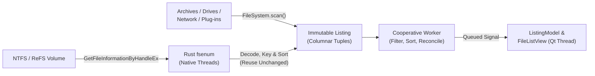
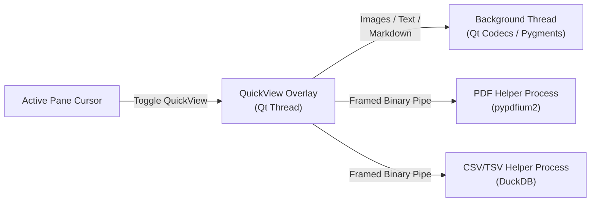

# Architecture

{{ app_name }} keeps the Qt user interface thin and reactive by moving scanning,
sorting, filtering and heavy previews off the UI thread.

## Snapshot Pane Pipeline

Each file pane displays an immutable columnar snapshot (`fman.listing.Listing`)
instead of querying files one by one on the UI thread.

- **Native Rust Enumerator (`fsenum`)**: On local NTFS and ReFS folders, native
  threads overlap Windows kernel directory calls with UTF-16 decoding and
  natural-order sorting. Unchanged refreshes reuse the displayed snapshot without
  rebuilding objects or resetting the table.
- **Immutable Snapshots**: Every provider produces a `Listing` of plain tuples
  (`names`, `is_dir`, `sizes`, `mtimes_ns`, `attributes`, `created_ns`,
  128-bit `identities`). No Qt objects cross thread boundaries.
- **Cooperative Projections**: Filtering, sorting and selection reconciliation
  run on worker threads that yield once per frame so keyboard input stays
  responsive even in folders with 200,000+ entries.
- **Virtual Viewport**: Qt reads cell text and icons lazily for visible rows
  only, backed by small bounded caches.

See [Performance](performance.md) for measured timings across versions.

## Isolated QuickView Helpers

Heavy document engines run outside the main application process so crashes,
memory spikes or slow parses never block the panes.

- **Cancellation & Stale Rejection**: Moving the cursor cancels pending loads
  and drops outdated frames by generation ID.
- **Windows Job Objects**: Helper processes are assigned to a kill-on-close job
  so they never linger if the application closes.
- **Zero Idle Cost**: When QuickView, Directory Size or Extended Status are off,
  they run no background scans, timers or helper processes.

## Plug-in Host and Layered Settings

Built-in features (`Core`, `SearchFiles`, `FindFiles`, `Everything`, `Favorites`,
`ChecksumFiles`, `ProcessPane`, `Robocopy`, `BatchFileRenamer`,
`FileAttributesEditor`) run on the same plug-in host as third-party extensions.

- **Portable State**: All mutable configuration, caches and session state stay
  under `UserSettings` beside the executable. The application never intentionally
  writes to the Windows Registry.
- **Comment-Preserving YAML**: User configuration files override bundled
  defaults differentially while preserving comments.

Start extending the application with [Your First Plug-in](plugins/index.md) or
browse the [API Overview](api/index.md).
