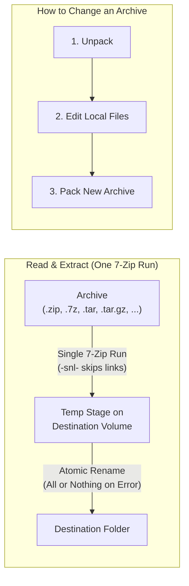

# Archives

{{ app_name }} opens archives as folders. It uses 7-Zip to read, unpack and pack them.

Archives are **read-only**: browse them, copy items out, unpack them or pack new ones.

| Type           | Extensions                                                                             |
| -------------- | -------------------------------------------------------------------------------------- |
| ZIP            | `.zip`, `.zipx`, `.jar`, `.xpi`                                                        |
| 7-Zip          | `.7z`                                                                                  |
| Tar            | `.tar`                                                                                 |
| Compressed tar | `.tar.gz`, `.tgz`, `.tar.bz2`, `.tbz2`, `.tbz`, `.tar.xz`, `.txz`, `.tar.zst`, `.tzst` |

## Browse an Archive

Press ++enter++ on an archive to open it.

Navigate inside it like any folder. Press ++backspace++ at its root to return to the containing folder.

- The first open reads the archive's list of entries once and keeps it in memory.
  Its folders then open without reading the archive again.
- A changed archive is read again.
- A compressed tar is decompressed to read its list. The status bar shows the
  progress, for example `Reading logs.tar.gz: 45%`. Nothing is written to disk.
- An archive that cannot be read does not open. A message gives the reason, for
  example `Cannot read logs.zip: Unexpected end of archive`.

## Unpack an Archive

Place the cursor on an archive. Choose a command from the file context menu or the Command Center:

| Command          | Result for `Reports.zip` in `C:\Work`                                                   |
| ---------------- | --------------------------------------------------------------------------------------- |
| **Unpack here**  | Creates the folder `C:\Work\Reports`                                                    |
| **Unpack to...** | Puts the archive's content into the folder you type, by default the other pane's folder |

<figure class="product-shot" markdown>
  
  <figcaption>Unpack to... extracts archive contents straight into the chosen folder without entering it.</figcaption>
</figure>

- Unpack only creates. Nothing is merged or overwritten:
  - **Unpack here** stops if `C:\Work\Reports` exists.
  - **Unpack to...** stops if any top-level item of the archive exists in the chosen folder.
- **Unpack to...** creates a missing folder. A relative path starts at the current folder.
  If Unpack fails, the folders it created are removed.
- An archive with names that Windows would change, or names that collide, is
  refused. For example `aux.c`, or both `Makefile` and `makefile`.
- Cancel removes unfinished output.

**Unpack here** is also **Unpack archive** and **Extract archive** in the Command Center.

## Copy Items Out

Enter an archive, select items, then press ++f5++. Paste and drop work too.

The usual Copy prompt, folder merge and overwrite questions apply.

- All chosen items of one archive are extracted in one 7-Zip run. If the run
  fails or is canceled, none of them is copied.
- The extracted items are then moved into place. Cancel stops this step; the
  items already moved stay, each complete.
- An item that cannot be moved into place, for example over a read-only file,
  is skipped. The other items are still copied. One message at the end names
  the skipped items: `1 of 5 items was not copied: f3.txt: Access is denied`.
- 7-Zip changes names that Windows does not allow. Inside a copied folder,
  `aux.c` becomes `_aux.c`, and of `Makefile` and `makefile` one remains.
  Copied on its own, `aux.c` is reported as not extracted, while `Makefile`
  keeps its own content. Chosen together, `Makefile` and `makefile` are both
  skipped. Use **Unpack** to have such an archive refused instead.
- Some archives store names both with and without a leading `./`. From these,
  choose files or all items; a chosen folder is refused.

## Pack Files

Select files, then press ++alt+f5++.

<figure class="product-shot" markdown>
  
  <figcaption>The suggested archive goes to the other pane's folder.</figcaption>
</figure>

- Change the extension to `.7z` or `.tar` to choose the format.
- Pack creates a new archive. An existing archive name or a missing folder is refused.
- Two chosen items with the same name are refused, for example from search
  results. Nothing is written.
- Pack takes local files and folders. Compressed tars cannot be packed.
- The Command Center name is **Pack to archive (.zip, .7z, .tar)**.

To pack into the **current folder**, run **Pack here** from the Command Center
or file context menu. Only the default destination changes; the archive prompt
still lets you change the filename, destination and format.

## Change an Archive

Every change to an archive is refused with one message:

```text
Archives are read-only. Unpack the archive, change the files and pack them again.
```

This covers copy or move into an archive, move out of it, and Rename, Delete
and New folder inside it. To change an archive:

1. **Unpack** it.
2. Change the files.
3. **Pack** them into a new archive.



## Symbolic Links

Symbolic links inside an archive are never created. Copy and Unpack skip them
and report how many were skipped. Hard links come out as ordinary files.

## From Explorer's Archive View

Windows Explorer opens `.zip`, `.7z` and `.tar` files as folders. Windows 11 also
opens compressed tars such as `.tar.gz`.
Copy items there and paste them into a pane, or drag them onto a pane:

| In Explorer, inside `Reports.zip`  | In {{ app_name }}           |
| ---------------------------------- | --------------------------- |
| Select items, press ++ctrl+c++     | Press ++ctrl+v++ in a pane  |
| Drag items                         | Drop onto a pane or folder  |

- The items are extracted with the usual copy prompt, progress and Cancel.
- They are always copied. Cut (++ctrl+x++) and ++shift++ do not change the archive.
- The archive type needs an entry in `archive_handlers` (see [Configuration](configuration.md)).
  Otherwise nothing is copied and a message explains why.

## Limits

- There is no password prompt. Encrypted items are refused with `The archive needs a password`.
- Formats 7-Zip cannot read, such as `.rar` and `.iso`, are not supported.
- Single compressed files that are not tars (`.gz`, `.xz`, `.bz2`, `.zst`) are not supported.
- Avoid changing an archive while an operation reads it.

See [Archive usage](https://github.com/RoyiAvital/RoyiFileManager/blob/main/src/main/resources/base/Plugins/Core/README.md#archive-transfers).
See [Advanced Notes](advanced.md#file-transfers) for local-copy and recovery cautions.
