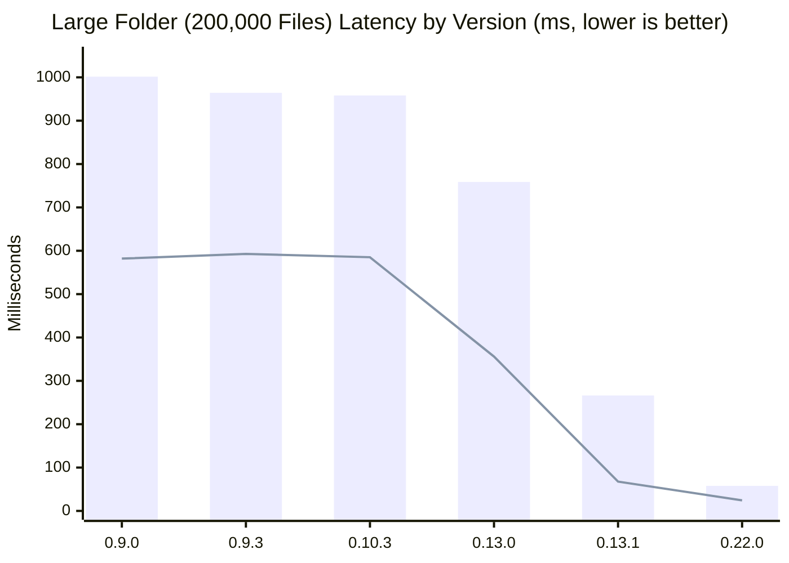
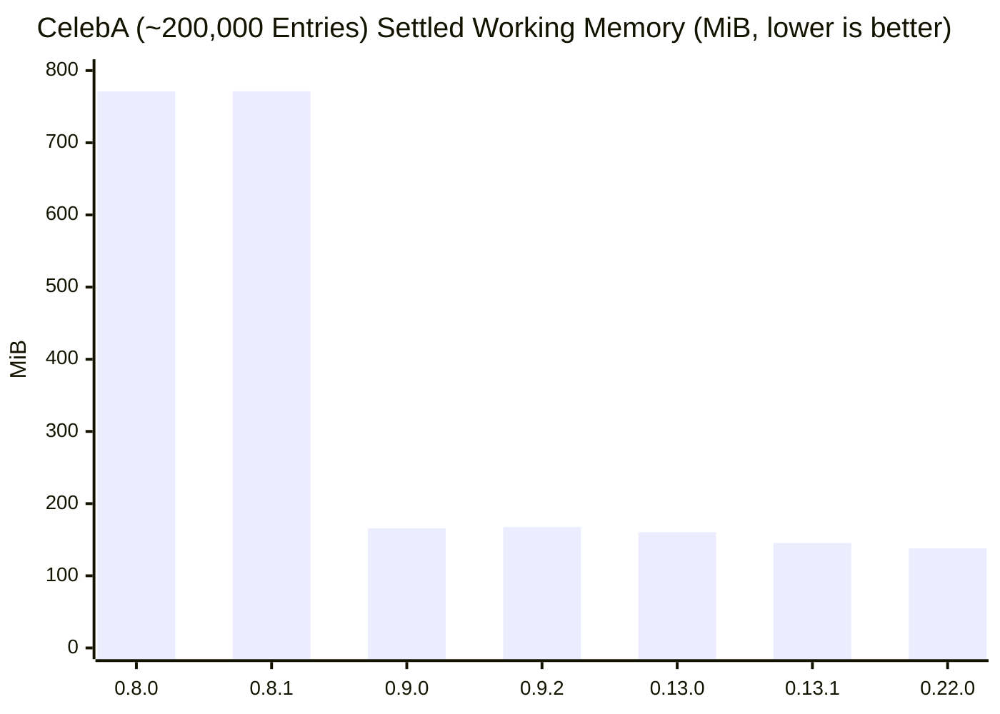

# Performance

!!! danger "Take Performance Seriously"
    Minimize _Time to render a pane_ (TTRP), _Time to apply a filter_ (TTAF) and _Time to apply a fuzzy find_ (TTAFF).

The latest published benchmark suite is tested on version `0.22.0`.

## Current Published Suite

Run time in [ms], lower is better.

| Test                            |   0.9.0 |   0.9.3 | 0.10.3 | 0.13.0 | 0.13.1 | 0.22.0 |
| ------------------------------- | ------: | ------: | -----: | -----: | -----: | -----: |
| Pane Load - Small Folder        |   42.23 |   35.20 |  33.93 |  37.52 |  37.02 |  33.98 |
| Pane Load - Large Folder        | 1001.54 |  964.31 | 958.23 | 758.64 | 266.27 |  57.78 |
| Filter Bar - Small Folder       |    8.96 |    8.69 |   8.79 |  10.88 |   9.77 |   8.31 |
| Filter Bar - Large Folder       |  332.17 |  331.28 | 338.27 | 364.34 | 289.53 | 260.81 |
| Fuzzy Find - Small Folder       |    4.57 |    4.55 |   7.17 |   5.28 |   4.86 |   4.52 |
| Fuzzy Find - Large Folder       |  408.47 |  407.95 | 441.02 | 357.29 | 354.73 | 354.89 |
| Fuzzy Find (Recursive)          |   91.68 |   91.05 |  91.91 |  92.54 |  91.28 |  90.79 |
| QuickView Images - Small Folder |  122.09 |  122.61 | 122.04 | 121.09 | 116.37 | 121.70 |
| QuickView Images - Large Folder |  123.29 |  121.14 | 135.86 | 119.46 | 120.62 | 121.10 |
| QuickView Text - Small Folder   |       - |       - | 133.03 | 129.55 | 132.58 | 134.23 |
| QuickView Text - Large Folder   |       - |       - | 129.47 | 132.35 | 131.50 | 131.74 |
| QuickView CSV - Full Import     |       - |       - |      - |      - |      - | 916.70 |
| Selections - Small Folder       |   15.67 |   15.24 |  15.35 |  16.18 |  15.79 |  13.60 |
| Selections - Large Folder       |   88.18 |   87.85 |  88.36 |  89.65 |  87.64 |  29.59 |
| Selections Readback             | 1994.44 | 1974.51 |  73.78 |  69.86 |  65.65 |  67.49 |
| Navigation                      |    7.17 |    7.36 |   7.17 |   7.05 |   6.97 |   6.36 |
| Refresh / Selection             |  581.97 |  592.84 | 585.17 | 355.99 |  67.59 |  24.29 |

Small folders contain 256 files. Large folders contain 200,000 files. Recursive Find uses 50,000 files. QuickView CSV opens a 64 MB, 32-column CSV file.

Results use Windows and NTFS with warm caches and medians of three fresh processes per test.

## Version Comparison

[CelebA](https://mmlab.ie.cuhk.edu.hk/projects/CelebA.html) folder with about 200,000 entries. Lower is better.

| Measurement                | Ver. 0.8.0  | Ver. 0.8.1  | Ver. 0.9.0  | Ver. 0.9.2  | Ver. 0.13.0 | Ver. 0.13.1 | Ver. 0.22.0 |
| -------------------------- | ----------- | ----------- | ----------- | ----------- | ----------- | ----------- | ----------- |
| First Populated Pane Paint | 8.949 [s]   | 5.663 [s]   | 0.583 [s]   | 0.506 [s]   | 0.257 [s]   | 0.112 [s]   | 0.052 [s]   |
| Metadata Loading Complete  | 17.786 [s]  | 11.498 [s]  | 0.571 [s]   | 0.494 [s]   | 0.244 [s]   | 0.100 [s]   | 0.042 [s]   |
| Post Paint Qt Commit Work  | 2.765 [s]   | 1.282 [s]   | 0 [s]       | 0 [s]       | 0 [s]       | 0 [s]       | 0 [s]       |
| Settled Working Memory     | 771.1 [MiB] | 771.3 [MiB] | 165.6 [MiB] | 167.4 [MiB] | 160.3 [MiB] | 145.5 [MiB] | 138.1 [MiB] |

All runs used alternating fresh processes, warm OS caches, hidden filtering enabled and QuickView and extended status disabled. Do not chain percentages across the two runs.

First populated paint dropped from **8,949 ms** (`0.8.0`) to **583 ms** (`0.9.0`), **112 ms** (`0.13.1`), and **52 ms** (`0.22.0`). See [Architecture](architecture.md) for how the native Rust enumerator and snapshot model achieve this.

!!! note "Architecture Milestones"
    - **0.22.0**: Replaced the C directory parser with a native Rust enumerator (`fsenum`) that reads, keys and sorts NTFS/ReFS folders on its own threads, reuses unchanged listings on refresh, and loads 1,000,000 files in ~0.2 s while keeping the UI responsive.
    - **0.13.1**: Added native C natural sort keys and an unchanged-refresh fast path without re-sorting or table resets.
    - **0.13.0**: Added a native C directory parser and a validation-free snapshot fast path for NTFS/ReFS folders.
    - **0.10.x**: Optimized existing paths and removed slower legacy code.
    - **0.9.x**: Introduced the Snapshot Architecture — an order of magnitude faster than `0.8.1`.
    - **0.8.0–0.8.1**: Original `fman`-derived architecture.

## File Operations: Live and Deferred Refresh

Copying 10,000 files of 4 KiB with Ctrl+A and F5 until the destination pane shows
every file. Medians of three fresh processes, in seconds; lower is better.

| Destination Before Copy | Live Refresh (Default) | Live Refresh Off |
| ----------------------- | ---------------------: | ---------------: |
| Empty                   | 63.5                   | 10.4             |
| 200,000 files           | 71.1                   | 10.3             |

With live refresh on, the destination pane rescans during the whole copy. Turn it
off with **Toggle live refresh during file operations**; see
[Configuration](configuration.md#live-refresh-during-file-operations).